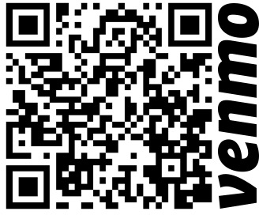

There are numerous ways you can help me meet my living needs.

## Patreon

You can support me with a Patreon membership which includes two of my best photographs emailed to you each month. Beyond the basic membership, you'll get a handwritten thank you letter.


  Sign up on <svg class="display: inline-block; margin-bottom: -15px;" height="20px" version="1.1" viewBox="0 0 569 546" width="30px" xmlns="http://www.w3.org/2000/svg"><title>Patreon logo</title><g><circle style="fill: rgb(249, 104, 84)" cx="362.589996" cy="204.589996" data-fill="1" r="204.589996"></circle><rect data-fill="2" height="545.799988" width="100" x="0" y="0"></rect></g></svg>atreon.


---

## One-time

If you're feeling more like just giving a one time infusion of money, you can use the following methods:

### PayPal


  Tip me with .


### Venmo


  Tip me with Venmo.


### Bitcoin (BTC)

Tip me with bitcoin: `12btx2Kjymx4VWJMJ6q7Z6cu3r1QGRVCLd`

### Ethereum (ETH)

Tip me with Ethereum: `0x20103b0C6fD22cc4BfA41E7437D84AB8A3F805c6`

